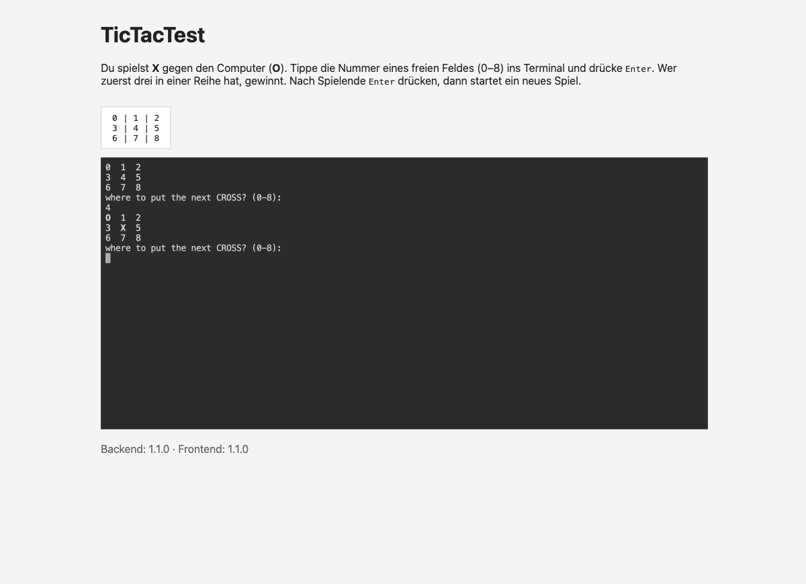

# Deployment von TicTacTest (EC2 im Learner Lab)

TicTacTest läuft als Web-App auf einer EC2-Instanz. OpenTofu (`infra/`) stellt bereit, **wohin und wie** deployt
wird. **Welche Version** läuft, entscheidet das Deployment. So kann man einen neuen Release deployen, ohne die
Infrastruktur neu zu erstellen.

```
Browser ── http://<IP>/ ── nginx ─┬─ /                     Frontend (aus tictactest-frontend-X.Y.Z.zip)
                                  ├─ /config.js            Konfiguration (von der Infrastruktur)
                                  ├─ /backend/version.txt  Versionsabfrage (aus dem Manifest im JAR)
                                  └─ /tty/  (WebSocket) ── ttyd ── java -jar tictactest.jar   (ein Prozess pro Spiel)
```

## Infrastruktur (`infra/`)

| Datei | Inhalt |
|---|---|
| `main.tf` | Instanz mit `LabInstanceProfile`, Elastic IP, Security Group, Key-Pair |
| `setup.sh` | `user_data`: Einrichtung beim ersten Start (Java, ttyd, nginx, Dienst, `config.js`, Deploy-Skript) |
| `variables.tf` | Region, Instanztyp, ttyd-Version + Prüfsumme, GitHub-Repo |
| `outputs.tf` | URLs und Instanz-ID (siehe unten) |

| Anforderung | Umsetzung |
|---|---|
| Feste öffentliche Adresse | `aws_eip`: die IP bleibt, auch wenn das Learner Lab die Instanz stoppt und startet |
| Zugriff auf AWS ohne Access Keys | vorhandenes `LabInstanceProfile` (eigene IAM-Rollen sind im Lab verboten). Damit nimmt die Instanz SSM-Befehle an. |
| Laufzeit reproduzierbar | Corretto 25 und nginx aus dem Amazon-Linux-Repo, ttyd mit fester Version **und** SHA-256-Prüfsumme |
| Dienst | systemd-Unit `ttyd.service`: startet beim Booten, läuft als Benutzer `tictactest` (nicht root, keine Login-Shell), `Restart=always`, startet **nur** das JAR |
| Speicher | `-m 5` (max. 5 Spiele gleichzeitig) und `-Xmx64m` pro JVM, damit die `t2.micro` (1 GB) nicht vollläuft |

**Security Group:**

| Port | Wer | Warum |
|---|---|---|
| 80 | alle | Frontend, Terminal und Versionsabfrage über nginx. ttyd selbst hört nur auf `127.0.0.1:7681`. |
| 22 | `var.ssh_cidr` | nur zur Fehlersuche. Das Deployment braucht SSH nicht (SSM). Besser auf die eigene IP einschränken. |

Raus ist alles erlaubt (Pakete, Download vom GitHub-Release, Verbindung zu SSM).

### Frontend: nginx statt S3

Geplant war ein S3-Bucket als Static Website. Im Learner Lab bricht `tofu apply` beim Bucket aber ab: Der AWS-Provider
liest bei jedem Bucket die Object-Lock-Konfiguration, und genau das verbietet eine Service Control Policy vom Lab
(`AccessDenied ... s3:GetBucketObjectLockConfiguration ... explicit deny in a service control policy`, auch mit
Provider 5.x). Darum liefert nginx auf der Instanz das Frontend aus.

Das Frontend bleibt trotzdem getrennt: eigenes Release-Asset, eigenes Deployment, eigener Ordner (`/var/www/tictactest`).
Vorteil: Frontend und Web-Konsole haben dieselbe Origin, CORS ist nicht nötig.

### config.js kommt von der Infrastruktur

`setup.sh` schreibt `/opt/tictactest/config.js`, nginx liefert sie unter `/config.js` aus. Weil Frontend und Terminal
auf demselben Server laufen, reichen relative Pfade (`/tty/`, `/backend/version.txt`), es steht keine IP im Code.
Die Datei liegt **ausserhalb** vom Frontend-Ordner, ein Frontend-Deployment kann sie also nicht löschen.

Öffentlich ausgeliefert wird nur, was im Frontend-Archiv steht. Dort darf nie etwas Geheimes landen (Credentials,
Schlüssel, `tfstate`), weil jeder die Dateien lesen kann.

### Wie kommt das JAR auf die Instanz?

Die Instanz lädt es **direkt vom GitHub-Release** und prüft die SHA-256-Prüfsumme. Das macht das Skript
`/usr/local/bin/tictactest-deploy` (aus `setup.sh`):

```bash
tictactest-deploy backend 1.1.0    # JAR holen, prüfen, version.txt aus dem Manifest schreiben, ttyd neu starten
tictactest-deploy frontend 1.1.0   # Archiv holen, prüfen, Frontend-Ordner komplett ersetzen
```

| Frage | Antwort |
|---|---|
| Warum GitHub-Release? | Einfachste Lösung: kein zusätzlicher Bucket, deployt wird genau das Release-Artefakt. |
| Repo privat? | Dann bräuchte die Instanz ein GitHub-Token. Besser wäre dann ein privater S3-Bucket, den die Instanz über das Instance Profile liest. |
| Welche Version nach einem Neustart? | Das JAR liegt auf der Disk (EBS) unter `/opt/tictactest/tictactest.jar`. systemd startet einfach wieder dieses. |
| Version wechseln? | `tictactest-deploy backend <neue Version>` per SSM, die Instanz bleibt. |
| Warum nicht in `user_data`? | `user_data` läuft nur beim ersten Start. Eine neue Version hätte eine neue Instanz gebraucht. Darum steht in `setup.sh` keine Version. |

`user_data_replace_on_change = true`: Ändert sich `setup.sh`, erstellt OpenTofu eine **neue** Instanz, sonst würde die
Änderung nie ausgeführt. Die Elastic IP wird umgehängt, die App muss danach neu deployt werden.

### Outputs

| Output | Wofür | Vertraulich? |
|---|---|---|
| `frontend_url` | hier spielen | nein |
| `terminal_url`, `version_url` | Web-Konsole, Versionsabfrage | nein |
| `instance_id` | Ziel für `aws ssm send-command` (Pipeline) | nein, ohne AWS-Zugang nutzlos |
| `public_ip`, `ssh_command` | Fehlersuche | nein, der private Schlüssel bleibt lokal |

Vertraulich sind nur die AWS-Credentials und der private SSH-Schlüssel. Sie stehen in keinem Output und nicht im Repo.

## Deploy von Hand

**SSM statt SSH:** `aws ssm send-command` braucht nur AWS-Credentials, die die Pipeline sowieso hat. Mit SSH bräuchte
GitHub zusätzlich den privaten Schlüssel, und Port 22 müsste für die (wechselnden) IPs von GitHub offen sein.
Nachteil von SSM: Der Befehl läuft asynchron, man muss auf das Ergebnis warten und es abholen.

```bash
# 0. Credentials aus dem Learner Lab (AWS Details → AWS CLI) nach ~/.aws/credentials kopieren
aws sts get-caller-identity

# 1. Infrastruktur (nur wenn sie sich ändert)
cd infra
tofu init
tofu apply
I=$(tofu output -raw instance_id)
IP=$(tofu output -raw public_ip)

# 2. Release deployen (hier 1.1.0): Backend und Frontend
C=$(aws ssm send-command --instance-ids $I --document-name AWS-RunShellScript \
  --parameters 'commands=["tictactest-deploy backend 1.1.0","tictactest-deploy frontend 1.1.0"]' \
  --query Command.CommandId --output text)
aws ssm wait command-executed --command-id $C --instance-id $I
aws ssm get-command-invocation --command-id $C --instance-id $I --query '[Status,StandardOutputContent]'

# 3. Prüfen
curl http://$IP/backend/version.txt   # 1.1.0
curl http://$IP/version.txt           # 1.1.0 (Frontend)
tofu plan                             # No changes: das Deployment hat die Infrastruktur nicht verändert
```

### Release A (1.1.0)

Deployt mit den Befehlen oben, im Browser gespielt, beide Versionen werden angezeigt:



### Release B (1.1.1)

Sichtbare Änderung im Frontend (blauer Titel) und neue Version. Deployt mit denselben Befehlen wie oben, nur mit
`1.1.1`, **ohne** `tofu apply` und ohne neue Instanz. Danach muss `tofu plan` „No changes“ zeigen.

## Robustheit (24.11.2026)

| Experiment | Ergebnis |
|---|---|
| Instanz stoppen und starten (wie Ende einer Lab-Session) | IP gleich (Elastic IP), ttyd und nginx starten von selbst, es läuft wieder **1.1.0**. Nichts zu tun. |
| Einrichtung ändern (neue `Environment=`-Zeile in der Unit) | `tofu plan`: `aws_instance.tictactest must be replaced` (`user_data # forces replacement`), Elastic IP `updated in-place`. Die IP bleibt, aber die neue Instanz ist leer: die App muss neu deployt werden. |
| `tofu destroy` + `tofu apply` | Neue Instanz-ID **und neue IP** (`100.30.10.114` → `34.199.145.79`), weil auch die Elastic IP neu ist. Terminal leer, Versionsabfrage 404, Frontend 403. Nötig: Release neu deployen (Schritt 2). Danach läuft 1.1.0 und `tofu plan` zeigt keine Änderung. |
