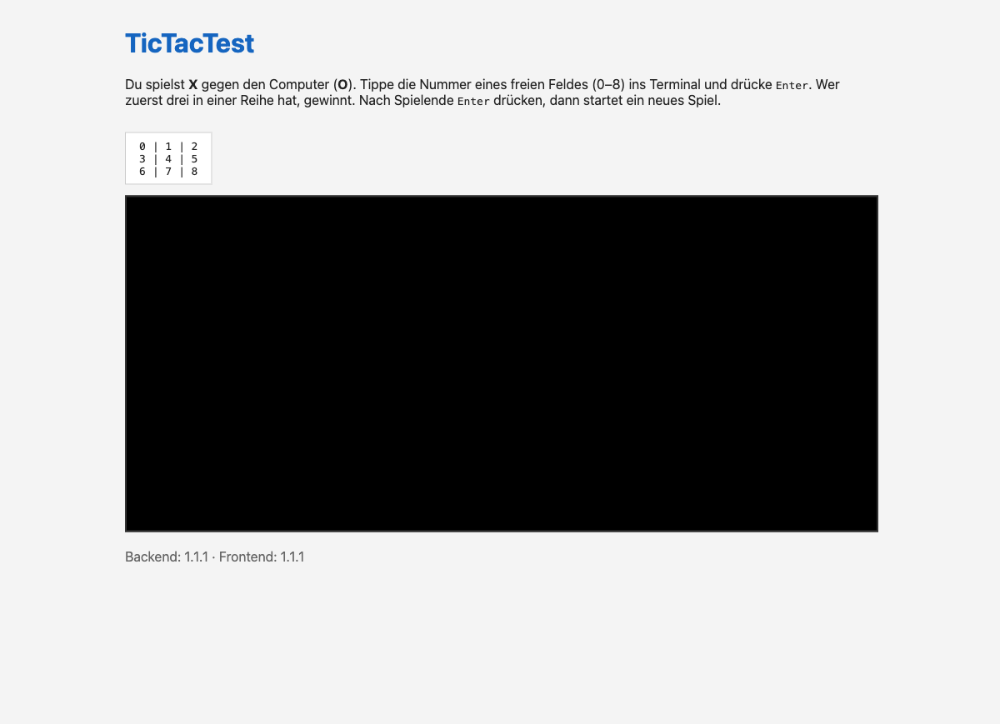

# Deployment von TicTacTest (EC2 im Learner Lab)

TicTacTest läuft als Web-App auf einer EC2-Instanz. OpenTofu (`infra/`) stellt bereit, **wohin und wie** deployt
wird. **Welche Version** läuft, entscheidet das Deployment. So kann man einen neuen Release deployen, ohne die
Infrastruktur neu zu erstellen.

```
Browser ── http://<IP>/ ── nginx ─┬─ /                     Frontend (aus tictactest-frontend-X.Y.Z.zip)
                                  ├─ /config.js            Konfiguration (von der Infrastruktur)
                                  ├─ /backend/version.txt  Versionsabfrage (aus dem Manifest im JAR)
                                  └─ /tty/  (WebSocket) ── ttyd ── java -jar tictactest.jar   (ein Prozess pro Spiel)
```

## Infrastruktur (`infra/`)

| Datei | Inhalt |
|---|---|
| `main.tf` | Instanz mit `LabInstanceProfile`, Elastic IP, Security Group, Key-Pair |
| `setup.sh` | `user_data`: Einrichtung beim ersten Start (Java, ttyd, nginx, Dienst, `config.js`, Deploy-Skript) |
| `variables.tf` | Region, Instanztyp, ttyd-Version + Prüfsumme, GitHub-Repo |
| `outputs.tf` | URLs und Instanz-ID (siehe unten) |

| Anforderung | Umsetzung |
|---|---|
| Feste öffentliche Adresse | `aws_eip`: die IP bleibt, auch wenn das Learner Lab die Instanz stoppt und startet |
| Zugriff auf AWS ohne Access Keys | vorhandenes `LabInstanceProfile` (eigene IAM-Rollen sind im Lab verboten). Damit nimmt die Instanz SSM-Befehle an. |
| Laufzeit reproduzierbar | Corretto 25 und nginx aus dem Amazon-Linux-Repo, ttyd mit fester Version **und** SHA-256-Prüfsumme |
| Dienst | systemd-Unit `ttyd.service`: startet beim Booten, läuft als Benutzer `tictactest` (nicht root, keine Login-Shell), `Restart=always`, startet **nur** das JAR |
| Speicher | `-m 5` (max. 5 Spiele gleichzeitig) und `-Xmx64m` pro JVM, damit die `t2.micro` (1 GB) nicht vollläuft |

**Security Group:**

| Port | Wer | Warum |
|---|---|---|
| 80 | alle | Frontend, Terminal und Versionsabfrage über nginx. ttyd selbst hört nur auf `127.0.0.1:7681`. |
| 22 | `var.ssh_cidr` | nur zur Fehlersuche. Das Deployment braucht SSH nicht (SSM). Besser auf die eigene IP einschränken. |

Raus ist alles erlaubt (Pakete, Download vom GitHub-Release, Verbindung zu SSM).

### Frontend: nginx statt S3

Geplant war ein S3-Bucket als Static Website. Im Learner Lab bricht `tofu apply` beim Bucket aber ab: Der AWS-Provider
liest bei jedem Bucket die Object-Lock-Konfiguration, und genau das verbietet eine Service Control Policy vom Lab
(`AccessDenied ... s3:GetBucketObjectLockConfiguration ... explicit deny in a service control policy`, auch mit
Provider 5.x). Darum liefert nginx auf der Instanz das Frontend aus.

Das Frontend bleibt trotzdem getrennt: eigenes Release-Asset, eigenes Deployment, eigener Ordner (`/var/www/tictactest`).
Vorteil: Frontend und Web-Konsole haben dieselbe Origin, CORS ist nicht nötig.

### config.js kommt von der Infrastruktur

`setup.sh` schreibt `/opt/tictactest/config.js`, nginx liefert sie unter `/config.js` aus. Weil Frontend und Terminal
auf demselben Server laufen, reichen relative Pfade (`/tty/`, `/backend/version.txt`), es steht keine IP im Code.
Die Datei liegt **ausserhalb** vom Frontend-Ordner, ein Frontend-Deployment kann sie also nicht löschen.

Öffentlich ausgeliefert wird nur, was im Frontend-Archiv steht. Dort darf nie etwas Geheimes landen (Credentials,
Schlüssel, `tfstate`), weil jeder die Dateien lesen kann.

### Wie kommt das JAR auf die Instanz?

Die Instanz lädt es **direkt vom GitHub-Release** und prüft die SHA-256-Prüfsumme. Das macht das Skript
`/usr/local/bin/tictactest-deploy` (aus `setup.sh`):

```bash
tictactest-deploy backend 1.1.0    # JAR holen, prüfen, version.txt aus dem Manifest schreiben, ttyd neu starten
tictactest-deploy frontend 1.1.0   # Archiv holen, prüfen, Frontend-Ordner komplett ersetzen
```

| Frage | Antwort |
|---|---|
| Warum GitHub-Release? | Einfachste Lösung: kein zusätzlicher Bucket, deployt wird genau das Release-Artefakt. |
| Repo privat? | Dann bräuchte die Instanz ein GitHub-Token. Besser wäre dann ein privater S3-Bucket, den die Instanz über das Instance Profile liest. |
| Welche Version nach einem Neustart? | Das JAR liegt auf der Disk (EBS) unter `/opt/tictactest/tictactest.jar`. systemd startet einfach wieder dieses. |
| Version wechseln? | `tictactest-deploy backend <neue Version>` per SSM, die Instanz bleibt. |
| Warum nicht in `user_data`? | `user_data` läuft nur beim ersten Start. Eine neue Version hätte eine neue Instanz gebraucht. Darum steht in `setup.sh` keine Version. |

`user_data_replace_on_change = true`: Ändert sich `setup.sh`, erstellt OpenTofu eine **neue** Instanz, sonst würde die
Änderung nie ausgeführt. Die Elastic IP wird umgehängt, die App muss danach neu deployt werden.

### Outputs

| Output | Wofür | Vertraulich? |
|---|---|---|
| `frontend_url` | hier spielen | nein |
| `terminal_url`, `version_url` | Web-Konsole, Versionsabfrage | nein |
| `instance_id` | Ziel für `aws ssm send-command` (Pipeline) | nein, ohne AWS-Zugang nutzlos |
| `public_ip`, `ssh_command` | Fehlersuche | nein, der private Schlüssel bleibt lokal |

Vertraulich sind nur die AWS-Credentials und der private SSH-Schlüssel. Sie stehen in keinem Output und nicht im Repo.

## Deploy von Hand

**SSM statt SSH:** `aws ssm send-command` braucht nur AWS-Credentials, die die Pipeline sowieso hat. Mit SSH bräuchte
GitHub zusätzlich den privaten Schlüssel, und Port 22 müsste für die (wechselnden) IPs von GitHub offen sein.
Nachteil von SSM: Der Befehl läuft asynchron, man muss auf das Ergebnis warten und es abholen.

```bash
# 0. Credentials aus dem Learner Lab (AWS Details → AWS CLI) nach ~/.aws/credentials kopieren
aws sts get-caller-identity

# 1. Infrastruktur (nur wenn sie sich ändert)
cd infra
tofu init
tofu apply
I=$(tofu output -raw instance_id)
IP=$(tofu output -raw public_ip)

# 2. Release deployen (hier 1.1.0): Backend und Frontend
C=$(aws ssm send-command --instance-ids $I --document-name AWS-RunShellScript \
  --parameters 'commands=["tictactest-deploy backend 1.1.0","tictactest-deploy frontend 1.1.0"]' \
  --query Command.CommandId --output text)
aws ssm wait command-executed --command-id $C --instance-id $I
aws ssm get-command-invocation --command-id $C --instance-id $I --query '[Status,StandardOutputContent]'

# 3. Prüfen
curl http://$IP/backend/version.txt   # 1.1.0
curl http://$IP/version.txt           # 1.1.0 (Frontend)
tofu plan                             # No changes: das Deployment hat die Infrastruktur nicht verändert
```

### Release A (1.1.0)

Deployt mit den Befehlen oben, im Browser gespielt, beide Versionen werden angezeigt:


### Release B (1.1.1)

Sichtbare Änderung im Frontend (blauer Titel) und neue Version. Deployt mit denselben Befehlen wie oben, nur mit
`1.1.1`, **ohne** `tofu apply` und ohne neue Instanz (gleiche Instanz-ID `i-0d082e4bdbf45932d`).
Ergebnis: Backend und Frontend melden `1.1.1`, `tofu plan` zeigt `No changes. Your infrastructure matches the configuration.`



## Robustheit (24.11.2026)

| Experiment | Ergebnis |
|---|---|
| Instanz stoppen und starten (wie Ende einer Lab-Session) | IP gleich (Elastic IP), ttyd und nginx starten von selbst, es läuft wieder **1.1.0**. Nichts zu tun. |
| Einrichtung ändern (neue `Environment=`-Zeile in der Unit) | `tofu plan`: `aws_instance.tictactest must be replaced` (`user_data # forces replacement`), Elastic IP `updated in-place`. Die IP bleibt, aber die neue Instanz ist leer: die App muss neu deployt werden. |
| `tofu destroy` + `tofu apply` | Neue Instanz-ID **und neue IP** (`100.30.10.114` → `34.199.145.79`), weil auch die Elastic IP neu ist. Terminal leer, Versionsabfrage 404, Frontend 403. Nötig: Release neu deployen (Schritt 2). Danach läuft 1.1.0 und `tofu plan` zeigt keine Änderung. |

## Automatisches Deployment (Auftrag 3)

```
git tag vX.Y.Z ──► release.yml
                     ├─ Job release: Tests, JAR + Frontend-Archiv bauen, GitHub-Release erstellen
                     └─ Job deploy (needs: release)
                          ├─ scripts/changes.sh: Vergleich mit dem vorherigen Release-Tag
                          ├─ AWS-Zugang prüfen (abgelaufene Credentials?)
                          ├─ backend geändert?  → scripts/deploy.sh backend X.Y.Z   → SSM → tictactest-deploy → Prüfung
                          └─ frontend geändert? → scripts/deploy.sh frontend X.Y.Z  → SSM → tictactest-deploy → Prüfung

Actions → deploy → "Run workflow" (Version eingeben) ──► deploy.yml: Backend + Frontend dieser Version
```

- **Nur bei einem Release:** Der Deploy-Job hängt im `release.yml`, und der startet nur bei einem Tag `v*`.
  Ein Push auf `main` startet nur `build.yml`, dort gibt es keinen Deploy-Schritt.
- **Release-Artefakte, nicht neu gebaut:** Die Instanz lädt JAR bzw. Archiv vom GitHub-Release und prüft die Prüfsumme.
- **Keine neue Infrastruktur:** Die Pipeline kennt nur `aws ssm send-command`. `tofu apply` läuft weiterhin nur lokal.
- **Nie zwei gleichzeitig:** Beide Workflows nutzen `concurrency: group: deploy`. Ein zweites Deployment wartet.
- Warum ein Job im `release.yml` und kein eigener Workflow mit `on: release`? Ein Release, der mit dem `GITHUB_TOKEN`
  erstellt wird, löst keine weiteren Workflows aus. Mit `needs: release` läuft das Deployment auch erst, wenn der
  Release wirklich existiert.

### Secrets-Konzept

| Wert | Wo | Warum |
|---|---|---|
| `AWS_ACCESS_KEY_ID`, `AWS_SECRET_ACCESS_KEY`, `AWS_SESSION_TOKEN` | **GitHub Secrets** | Zugang zum AWS-Konto, geheim |
| `INSTANCE_ID` | **GitHub Variable** | aus `tofu output instance_id`, nicht geheim (ohne AWS-Zugang nutzlos) |
| `APP_URL` | **GitHub Variable** | `http://<public_ip>`, ist sowieso öffentlich |
| `GITHUB_TOKEN` | automatisch | für `gh release view`, gilt nur während des Laufs |

**Secrets vs. Variables:** Secrets sind verschlüsselt, man kann sie nach dem Speichern nicht mehr ansehen, und in Logs
werden sie als `***` ausgeblendet. Variables sind normaler Text, sichtbar für alle mit Zugriff auf die Einstellungen,
und erscheinen im Log. Faustregel: Alles, was Zugriff gibt, ist ein Secret. Alles, was nur eine Adresse oder ID ist,
ist eine Variable.

**Woher, wie lange gültig?** Learner Lab → *AWS Details* → *AWS CLI*. Das sind temporäre Credentials der Rolle
`voclabs` mit Session Token, gültig nur für die laufende Lab-Session (ca. 4 h).

**Nach jeder neuen Session** (bzw. vor einem Release) die drei Secrets erneuern:

```bash
# Credentials zuerst lokal in ~/.aws/credentials, dann ohne Anzeige in GitHub übernehmen
aws configure get aws_access_key_id     | gh secret set AWS_ACCESS_KEY_ID
aws configure get aws_secret_access_key | gh secret set AWS_SECRET_ACCESS_KEY
aws configure get aws_session_token     | gh secret set AWS_SESSION_TOKEN
```

**Release mit abgelaufenen Credentials:** Der Release selbst wird erstellt (braucht kein AWS). Im Deploy-Job schlägt der
Schritt *AWS-Zugang pruefen* mit `AWS-Credentials ungueltig oder abgelaufen` fehl, der Lauf ist rot und nichts wird
halb deployt. Nachholen: Lab starten, Secrets erneuern, dann *Actions → deploy → Run workflow* mit der Version.

**Wer sieht oder benutzt die Secrets?**
- Sehen: niemand, auch Admins können sie nur überschreiben.
- Benutzen: jeder Workflow im Repo, also jeder mit Schreibrechten (kann einen Workflow ändern).
- Logs: GitHub maskiert die Werte. Trotzdem nie `echo $AWS_SECRET_ACCESS_KEY` oder `set -x` mit Secrets. Die Logs
  der Läufe wurden kontrolliert, es erscheinen nur `***`.
- Forks und Pull Requests aus Forks bekommen **keine** Secrets. Darum deployt bei uns auch nur ein Tag, kein PR.

**Schaden, wenn ein Secret öffentlich wird:** Jemand könnte im Lab-Konto Instanzen starten (Budget weg, Krypto-Mining),
unsere Instanz per SSM übernehmen oder alles löschen. Reaktion: Lab-Session beenden bzw. *Reset* (macht die Credentials
ungültig), neue Credentials setzen, im Konto nach fremden Ressourcen suchen, Lehrperson informieren. Dass die Tokens
nach ein paar Stunden sowieso ablaufen, begrenzt den Schaden.

**In einem echten Unternehmen: OIDC.** GitHub Actions bekommt bei jedem Lauf ein kurzlebiges, signiertes Token
(OpenID Connect). AWS vertraut GitHub als Identity Provider und gibt dafür über `sts:AssumeRoleWithWebIdentity`
temporäre Credentials für eine Rolle mit genau den nötigen Rechten (z.B. nur `ssm:SendCommand` auf diese Instanz).
Die Rolle kann man auf ein Repo und einen Branch/Tag oder ein Environment einschränken. Es gibt dann **kein
gespeichertes Secret** mehr, das ablaufen oder geleakt werden kann. Im Learner Lab geht das nicht, weil wir keine IAM-Rollen
und keinen Identity Provider anlegen dürfen.

### Änderungen zwischen Releases erkennen

`scripts/changes.sh <tag>` vergleicht den Tag mit dem **vorherigen Release-Tag**
(`git describe --tags --abbrev=0 --match 'v*' <tag>^`):

| Pfad | zählt als |
|---|---|
| `src/main/`, `settings.gradle`, `gradle/` | Backend (kommt ins JAR) |
| `build.gradle` | Backend, aber nur wenn sich **mehr als** die Zeile `version = …` ändert (die ändert sich bei jedem Release) |
| `frontend/` | Frontend |
| `src/test/`, `docs/`, `*.md`, `.github/`, `scripts/`, `infra/` | weder noch (Tests, Doku, Betrieb). `infra/` wird mit `tofu apply` ausgerollt, nicht mit einem Release. |

- **Warum mit dem vorherigen Tag und nicht mit dem letzten Commit?** Zwischen zwei Releases liegen oft viele Commits
  (mehrere PRs). Der letzte Commit ist z.B. nur „Version erhöhen“. Laufen tut aber die Version vom letzten Release,
  darum muss alles seit diesem Release betrachtet werden.
- **Erster Release:** Es gibt keinen vorherigen Tag, also wird alles deployt.
- **Warum nicht `paths:` im Workflow?** Der `paths`-Filter wirkt nur bei Push/PR auf Branches und vergleicht mit dem
  vorherigen Push. Bei einem Tag-Push wird er ignoriert, und er kann nicht zwei Tags vergleichen.
- Getestet mit den alten Tags: `v1.0.0` → beides (erster Release), `v1.0.1` → Backend, `v1.1.0` und `v1.1.1` → nur Frontend.

### Backend und Frontend deployen

`scripts/deploy.sh backend|frontend <version>` macht:

1. `aws ssm send-command` → auf der Instanz `tictactest-deploy …` (Download, Prüfsumme, ersetzen, Neustart)
2. Beim Backend zusätzlich ein Smoke-Test auf der Instanz: Startet das JAR und fragt nach dem ersten Zug?
3. Auf das Ergebnis warten. Status nicht `Success` → Workflow schlägt fehl.
4. Von aussen per HTTP prüfen (`/backend/version.txt` bzw. `/version.txt`), dass **genau** die neue Version
   ausgeliefert wird. Nach 60 Sekunden ohne Erfolg schlägt der Workflow fehl.

**Frontend:** Der Ordner `/var/www/tictactest` wird komplett durch den Inhalt des Archivs ersetzt, gelöschte Dateien
verschwinden. `config.js` liegt in `/opt/tictactest` und wird darum nicht angefasst. Würde ein Frontend-Deployment die
Konfiguration löschen, fände `app.js` keine `TICTACTEST_CONFIG`: das Terminal bliebe leer und es stünde „config.js
fehlt“. Darum ist `config.js` nicht im Archiv und liegt nicht im Frontend-Ordner. Schlägt der Download fehl, bleibt das
alte Frontend stehen (ersetzt wird erst am Schluss).

**Spieler während des Neustarts:** `systemctl restart ttyd` beendet alle laufenden Java-Prozesse, laufende Partien
brechen ab. Verhindern könnte man das z.B. so: neue Version auf einem zweiten Port starten, nginx auf den neuen Port
umstellen (`nginx -s reload` trennt keine bestehenden Verbindungen) und die alte Version erst beenden, wenn keine
Partie mehr läuft (Blue/Green). Oder nur deployen, wenn niemand spielt.

**Welche Version nach einem Neustart im Lab?** Die zuletzt deployte: Das JAR liegt auf der Disk der Instanz, systemd
startet es beim Booten wieder.

### Gezielt eine Version deployen

*Actions → deploy → Run workflow*, Version z.B. `1.1.0` eingeben. Deployt Backend **und** Frontend dieser Version.
Die Eingabe wird geprüft (Format `X.Y.Z`, Release muss existieren) und nur über eine Umgebungsvariable verwendet,
damit man keine Befehle einschleusen kann.

| Fall | Vorgehen |
|---|---|
| Rollback | `deploy` mit der alten Version starten |
| Kaputter Release | Die Prüfung schlägt fehl (Smoke-Test oder Versionsprüfung), der Lauf ist rot. Danach `deploy` mit der letzten guten Version, das dauert ca. 1 Minute. |
| Nach `tofu destroy` + `tofu apply` | Neue `INSTANCE_ID` und `APP_URL` aus `tofu output` in den GitHub Variables eintragen, dann `deploy` mit der aktuellen Version. Die README-URL ändert sich, weil die Elastic IP neu ist. |

```bash
gh variable set INSTANCE_ID --body "$(tofu -chdir=infra output -raw instance_id)"
gh variable set APP_URL     --body "http://$(tofu -chdir=infra output -raw public_ip)"
gh workflow run deploy -f version=1.1.1
```

## Nachweis der Trennung

| Fall | Release / Lauf | Ergebnis |
|---|---|---|
| nur Doku/Pipeline (erster Release mit Deploy-Job) | _folgt_ | |
| nur Frontend | _folgt_ | |
| nur Backend | _folgt_ | |
| beides | _folgt_ | |
| Push auf `main` ohne Tag | _folgt_ | |
| Rollback | _folgt_ | |
| Fehlerfall | _folgt_ | |

## Reflexion: Umgebungen und Promotion

### Weg einer Änderung

```
Backend-Änderung (z.B. src/main/…/TicTacToeMain.java)
  Branch → PR (build.yml: Tests, Coverage-Gate) → Merge auf main (nichts wird deployt)
  → Version + CHANGELOG erhöhen → Tag vX.Y.Z
  → release.yml: Tests, JAR bauen, Smoke-Test, GitHub-Release mit JAR
  → deploy: changes.sh = backend → SSM → Instanz lädt JAR vom Release → ttyd neu starten
  → Smoke-Test + /backend/version.txt == X.Y.Z → grün

Frontend-Änderung (z.B. frontend/style.css)
  Branch → PR → Merge auf main (nichts wird deployt)
  → Version + CHANGELOG → Tag vX.Y.Z
  → release.yml: Frontend-Archiv (ohne config.js, mit version.txt) im GitHub-Release
  → deploy: changes.sh = frontend → SSM → Instanz ersetzt /var/www/tictactest (config.js bleibt)
  → /version.txt == X.Y.Z → grün
```

| Automatisch | Noch manuell |
|---|---|
| Tests, Build, Release, Änderungserkennung, Deployment, Versionsprüfung | Tag setzen (bewusste Entscheidung) |
| | `tofu apply` bei Änderungen an `infra/` |
| | Learner-Lab-Credentials in die Secrets kopieren (jede Session) |
| | `INSTANCE_ID`/`APP_URL` anpassen nach `tofu destroy` |

### Mehrere Umgebungen (dev, staging, prod)

Die OpenTofu-Konfiguration bräuchte eine Variable `environment`, die in Namen und Tags vorkommt
(`tictactest-${var.environment}`), sonst kollidieren z.B. Key-Pair und Security Group. Jede Umgebung bekommt einen
**eigenen State** (z.B. `tofu workspace` oder ein eigener State-Pfad pro Umgebung) und eine eigene `.tfvars`-Datei.

| Gleich in allen Umgebungen | Unterschiedlich |
|---|---|
| Code (`*.tf`, `setup.sh`), Betriebssystem, Java- und ttyd-Version | Instanztyp (dev klein, prod grösser), Anzahl Spiele (`-m`) |
| Ablauf des Deployments | IP/URL, Instanz-ID → eigene GitHub Variables pro Environment |
| die Release-Artefakte | SSH offen (dev) oder zu (prod), evtl. AWS-Konto |

### Promotion-Strategie

```
Tag vX.Y.Z ──► dev (automatisch) ──► staging (automatisch, wenn dev grün) ──► prod (Knopf + Freigabe)
                 Smoke-Test            E2E-Test im Browser                     Required Reviewer
```

- **Dasselbe Artefakt** wird weitergereicht, es wird **nicht** pro Umgebung neu gebaut. Nur so ist das, was in prod
  läuft, genau das, was in dev und staging getestet wurde (gleiche Prüfsumme). Ein neuer Build könnte andere
  Abhängigkeiten oder einen anderen Commit enthalten. Bei uns passt das schon: Deployt wird immer das Release-Asset.
- **Auslöser:** Push auf `main` → nur Tests (oder höchstens dev). Tag → Release und dev. Erfolgreicher Test in dev →
  staging. prod nur per manuellem Knopf (`workflow_dispatch` bzw. Freigabe).
- **Prüfung vor der nächsten Umgebung:** Smoke-Test (startet das JAR, läuft die richtige Version?) für dev. Für
  staging ein End-to-End-Test über die echte URL: Seite laden, im Terminal eine Partie spielen (z.B. mit Playwright),
  beide Versionen kontrollieren.
- **Wer darf nach prod?** GitHub Environments `dev`, `staging`, `prod` mit eigenen Secrets/Variables. `prod` mit
  *Required Reviewers* (z.B. Lehrperson/Teamleitung) und nur von Tags aus. Der Job wartet, bis jemand freigibt.
- **Änderungserkennung bei mehreren Umgebungen:** Der Vergleich „Tag gegen vorherigen Tag“ reicht dann nicht mehr. Wenn
  prod noch auf 1.1.0 ist und staging schon auf 1.3.0, darf man für prod nicht mit 1.2.0 vergleichen, sonst fehlt
  eine Änderung aus 1.2.0. Man muss mit der Version vergleichen, die **in dieser Umgebung läuft** (z.B. aus
  `/backend/version.txt` und `/version.txt` gelesen). Oder einfacher und sicherer: bei einer Promotion immer Backend
  **und** Frontend deployen (wie unser `deploy.yml`). Unveränderte Teile neu zu deployen schadet nicht, weil es
  dasselbe Artefakt ist.
