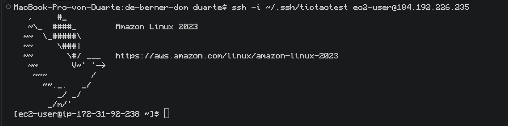
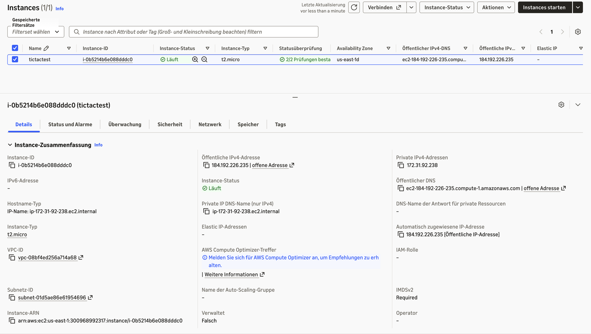

# Infrastructure as Code mit OpenTofu

Erste Cloud-Infrastruktur für TicTacTest: eine EC2-Instanz im AWS Learner Lab, die per SSH erreichbar ist.
Die Konfiguration liegt in [`infra/`](../infra).

## AWS Learner Lab

- Zugang über die Einladung zu AWS Academy, Kurs **324 HS26 IAC** → Learner Lab → *Start Lab*.
- Zugriff funktioniert (getestet am 18.11.2026 mit `aws sts get-caller-identity`, Rolle `voclabs`).
- Verfügbare Dienste (Auswahl): EC2, S3, VPC, Systems Manager (SSM), CloudWatch.
  Eigene IAM-Rollen kann man nicht anlegen, es gibt nur die vorgegebene `LabRole` bzw. das `LabInstanceProfile`.
- Region: `us-east-1`.

## Begriffe

| Begriff | Bedeutung |
|---|---|
| Infrastructure as Code | Server, Netzwerk usw. werden in Dateien beschrieben statt von Hand angeklickt. Die Dateien sind versioniert und das Ergebnis ist reproduzierbar. |
| Terraform | IaC-Werkzeug von HashiCorp. Seit 2023 nicht mehr Open Source (BSL-Lizenz). |
| OpenTofu | Open-Source-Abspaltung von Terraform (Linux Foundation). Gleiche Sprache (HCL), Befehl `tofu` statt `terraform`. |
| Provider | Plugin, das mit einer Plattform spricht, hier `hashicorp/aws`. Übersetzt die Konfiguration in API-Aufrufe. |
| Resource | Etwas, das OpenTofu anlegt und verwaltet, z.B. `aws_instance`. |
| Variable | Eingabewert, damit man die Konfiguration nicht ändern muss (z.B. Instanztyp). |
| Output | Ausgabewert nach dem `apply`, z.B. die öffentliche IP. |
| State | Datei (`terraform.tfstate`), in der OpenTofu speichert, welche echten Ressourcen zu welcher Konfiguration gehören. |

## Aufbau

| Datei | Inhalt |
|---|---|
| `infra/main.tf` | Provider `aws`, AMI-Suche (Amazon Linux 2023), Key-Pair, Security Group (Port 22), EC2-Instanz |
| `infra/variables.tf` | `region`, `instance_type` (`t2.micro`), `public_key_path`, `ssh_cidr` |
| `infra/outputs.tf` | `public_ip`, `public_dns`, `ssh_command` |

Der **Provider** sorgt dafür, dass OpenTofu überhaupt mit AWS reden kann.
Die **Ressourcen** beschreiben, was am Ende in AWS existieren soll. OpenTofu vergleicht das mit dem State und legt nur an, was fehlt.

## Ablauf

```bash
# einmalig: Schlüsselpaar erzeugen (privater Schlüssel bleibt in ~/.ssh, kommt nie ins Repo)
ssh-keygen -t ed25519 -f ~/.ssh/tictactest

# Zugangsdaten aus dem Learner Lab (AWS Details → AWS CLI) nach ~/.aws/credentials kopieren
aws sts get-caller-identity

cd infra
tofu init      # Provider herunterladen
tofu plan      # zeigt, was passieren würde (immer zuerst anschauen!)
tofu apply     # Ressourcen anlegen
tofu output    # IP und SSH-Befehl anzeigen
ssh -i ~/.ssh/tictactest ec2-user@<public_ip>
tofu destroy   # alles wieder löschen
```

## Nachweis (18.11.2026)

`tofu plan` zeigte `3 to add, 0 to change, 0 to destroy` (Key-Pair, Security Group, Instanz). Nach `tofu apply`:

```text
public_ip   = "184.192.226.235"
ssh_command = "ssh -i ~/.ssh/tictactest ec2-user@184.192.226.235"

$ ssh -i ~/.ssh/tictactest ec2-user@184.192.226.235
Login OK als ec2-user auf ip-172-31-92-238.ec2.internal
PRETTY_NAME="Amazon Linux 2023.12.20261117"
```





Danach wurde alles mit `tofu destroy` wieder entfernt.

## State und Git

Der State ist das Gedächtnis von OpenTofu. Ohne ihn weiss OpenTofu nicht mehr, welche Instanz es angelegt hat, und würde
beim nächsten `apply` eine zweite erstellen oder könnte die alte nicht mehr löschen. Im State stehen aber auch IDs, IPs und
eventuell Secrets im Klartext. Darum gehört er nicht ins Repo. Im Team legt man ihn in ein gemeinsames Backend (z.B. S3).

| In Git | Nicht in Git (siehe `.gitignore`) |
|---|---|
| `*.tf` | `*.tfstate`, `*.tfstate.*` |
| `.terraform.lock.hcl` (feste Provider-Version) | `.terraform/` (heruntergeladene Provider) |
| Dokumentation | `*.tfvars` (persönliche Werte) |
| | private SSH-Schlüssel, `*.pem` |
| | AWS Access Keys, Session Tokens, andere Secrets |

## Kosten

- Eine `t2.micro` kostet in `us-east-1` ca. 0.0116 USD pro Stunde (ca. 8.50 USD im Monat, wenn sie durchläuft).
  Dazu kommen Speicher (EBS) und ggf. eine öffentliche IPv4-Adresse.
- Im Learner Lab ist das Budget beschränkt. Ist es aufgebraucht, ist das Lab weg.

Massnahmen:

1. Nach dem Test immer `tofu destroy`, dann bleibt nichts liegen.
2. Kleinster Instanztyp als Standard-Variable (`t2.micro`).
3. Learner-Lab-Session beenden, dann werden Instanzen gestoppt.
4. Budget im Learner Lab regelmässig anschauen.

IaC hilft dabei, weil alles, was angelegt wurde, im Code und im State steht. Man vergisst keine Ressource und kann mit einem
Befehl alles wieder abbauen und später identisch neu aufbauen.

## Ausblick: CI/CD und Umgebungen

- Später soll auf der Instanz TicTacTest laufen. Dafür kommen noch Ports, Software (Java) und das Deployment dazu.
- In einer Pipeline könnte bei einer Änderung in `infra/` automatisch `tofu plan` laufen und das Ergebnis im Pull Request
  angezeigt werden. `apply` erst nach Freigabe.
- Mit Variablen (z.B. `environment = dev | staging | prod`) kann man dieselbe Konfiguration mehrmals aufbauen.
  So sind alle Umgebungen gleich aufgebaut und Fehler zeigen sich schon in dev statt in prod.
